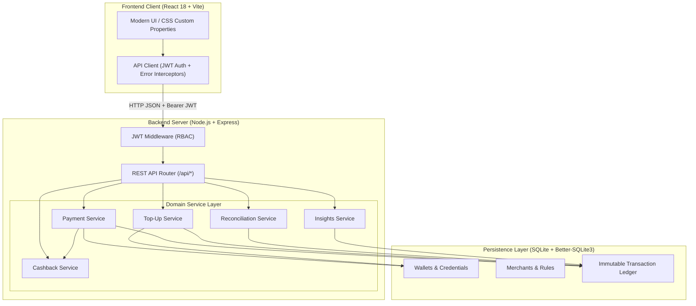

# FinPay Neo — Campus Digital Wallet

[](https://nodejs.org/)
[](https://expressjs.com/)
[](https://react.dev/)
[](https://vitejs.dev/)
[](https://www.sqlite.org/)
[](https://opensource.org/licenses/MIT)

FinPay Neo is a campus digital wallet and micro-payment platform tailored for university ecosystems. It facilitates friction-free payments across college merchants (canteens, stationery and print shops, shuttles, hostel dues, and campus stores), supports simulated digital top-ups, enforces strict financial guardrails (balance caps, daily spending ceilings, idempotency keys), and features an exact multi-tier cashback engine with monthly administrative reconciliation.

---

## Table of Contents

- [Core Features](#core-features)
- [System Architecture](#system-architecture)
- [Tiered Cashback Engine & Mathematical Model](#tiered-cashback-engine--mathematical-model)
- [Financial Safeguards & Integrity Controls](#financial-safeguards--integrity-controls)
- [Directory Structure](#directory-structure)
- [Quick Start Guide](#quick-start-guide)
  - [Prerequisites](#prerequisites)
  - [1. Backend Setup](#1-backend-setup)
  - [2. Frontend Setup](#2-frontend-setup)
- [Pre-Seeded Campus Personas](#pre-seeded-campus-personas)
- [Feature Walkthrough](#feature-walkthrough)
- [Automated Verification Suite](#automated-verification-suite)
- [REST API Reference](#rest-api-reference)
- [License](#license)

---

## Core Features

- **Merchant Payments**: Instant QR/code payments across 10 campus merchants with live cashback previews and scannable transaction receipts.
- **Simulated Top-Up Gateway**: Instant wallet loading via UPI, Debit/Credit Card, or Net Banking with balance limit controls.
- **Exact Tiered Cashback**: Multi-category rate configuration (0.25% to 2.0%) augmented by student membership tiers (Basic, Prime, Premium).
- **Audit-Proof Integer Arithmetic**: Eliminates IEEE 754 floating-point errors by executing all currency math in integer paise and basis points (bps).
- **Live Spending Insights**: 14-day spending trajectory, category distribution breakdown, and monthly cap progress meters.
- **Administrative Reconciliation**: Monthly finance dashboard displaying payment volumes, total cashback disbursed, effective category rates, wallet summaries, and one-click CSV report export.

---

## System Architecture



---

## Tiered Cashback Engine & Mathematical Model

The cashback mechanism runs on **integer basis-point arithmetic** to ensure mathematical determinism and avoid float drift:
$$\text{Cashback (paise)} = \left\lfloor \frac{\text{Amount (paise)} \times \text{Base Bps} \times \text{Tier Multiplier}}{10{,}000} \right\rfloor$$

### 1. Merchant Category Rules

| Category | Base Cashback Rate | Minimum Spend | Single-Payment Cap | Monthly Category Cap (Basic) |
|:---|:---:|:---:|:---:|:---:|
| **Food & Dining** (`CANTEEN`) | 1.50% (150 bps) | ₹20.00 | ₹10.00 | ₹50.00 |
| **Stationery & Print** (`STATIONERY`) | 2.00% (200 bps) | ₹10.00 | ₹15.00 | ₹40.00 |
| **Campus Transit** (`TRANSPORT`) | 1.50% (150 bps) | ₹10.00 | ₹10.00 | ₹30.00 |
| **Hostel & Housing** (`HOSTEL`) | 0.25% (25 bps) | ₹500.00 | ₹50.00 | ₹100.00 |
| **Campus Store** (`ONLINE`) | 2.00% (200 bps) | ₹100.00 | ₹25.00 | ₹60.00 |

### 2. Student Membership Tiers

| Tier | Rate Multiplier | Category Cap Multiplier | Monthly Overall Cashback Ceiling |
|:---|:---:|:---:|:---:|
| **Basic** | 1.00x | 1.00x | ₹150.00 |
| **Prime** | 1.25x | 1.50x | ₹250.00 |
| **Premium** | 1.50x | 2.00x | ₹400.00 |

### 3. Gating & Cap Hierarchy
For every payment, the reward is evaluated through a strict cascade:
1. **Minimum Spend Check**: If transaction amount is below the category threshold, reward = ₹0.
2. **Raw Award Calculation**: Base rate scaled by student's tier multiplier, floored to nearest paise.
3. **Per-Payment Ceiling**: Capped at category's single-payment maximum.
4. **Monthly Category Cap**: Cannot exceed category limit (scaled by tier cap multiplier).
5. **Monthly Overall Ceiling**: Total cashback across all categories in the calendar month cannot exceed the tier ceiling.
6. **Transparency Audit Note**: Every transaction stores the exact reason for any cap reduction.

---

## Financial Safeguards & Integrity Controls

- **Balance Ceiling**: Student wallets enforce a strict ₹20,000 maximum balance.
- **Daily Spend Limit**: Maximum spending ceiling of ₹10,000 per calendar day (IST).
- **Per-Payment Limit**: Single transaction maximum of ₹5,000.
- **Idempotency Guard**: All `/payments` and `/wallet/topup` requests require an `Idempotency-Key` header. Duplicate submissions with matching keys return the original receipt; attempts to alter amount or merchant using an existing key are rejected with HTTP 422.
- **Isolated Top-Up Accounting**: Wallet top-ups earn zero cashback and are strictly segregated from commercial merchant turnover during monthly financial reconciliation.
- **Timezone Standardization**: All daily ceilings and monthly reconciliation windows are pegged to Indian Standard Time (IST, UTC+05:30).

---

## Directory Structure

```
aisd-finpay/
├── .gitignore                      # Git exclusion rules for node, builds, and SQLite
├── README.md                       # Comprehensive system documentation
├── backend/
│   ├── .env.example                # Example environment configuration
│   ├── package.json                # Backend dependencies and test scripts
│   ├── src/
│   │   ├── app.js                  # Express application setup and middleware
│   │   ├── server.js               # HTTP listener entrypoint (port 4000)
│   │   ├── config/
│   │   │   └── rules.js            # Category rates, tier multipliers, and limits
│   │   ├── db/
│   │   │   ├── database.js         # Better-SQLite3 connection and initialization
│   │   │   └── seed.js             # Realistic 45-day seeded transaction history
│   │   ├── middleware/
│   │   │   └── auth.js             # JWT bearer verification and RBAC guards
│   │   ├── repositories/
│   │   │   ├── ledger.repository.js# Transaction persistence queries
│   │   │   └── rules.repository.js # Rule catalog data access
│   │   ├── routes/
│   │   │   └── api.js              # REST endpoint routes and validators
│   │   ├── services/
│   │   │   ├── cashback.service.js # Pure math engine for multi-tier rewards
│   │   │   ├── insights.service.js # Spending charts and monthly progress
│   │   │   ├── payment.service.js  # Transaction processing & balance mutation
│   │   │   ├── reconciliation.service.js # Monthly admin accounting summaries
│   │   │   └── topup.service.js    # Simulated deposit handler
│   │   └── utils/
│   │       ├── money.js            # Paise-to-rupee integer converters
│   │       ├── reference.js        # CSPRNG transaction reference generator
│   │       └── time.js             # IST timezone utilities
│   └── test/
│       ├── api.test.js             # API integration tests (Supertest)
│       └── cashback.test.js        # Pure unit tests for cashback math & caps
└── frontend/
    ├── index.html                  # HTML5 shell
    ├── package.json                # Frontend dependencies
    ├── vite.config.js              # Vite bundler configuration
    └── src/
        ├── App.jsx                 # View router and layout shell
        ├── api.js                  # Axios/Fetch wrapper with JWT handling
        ├── format.js               # Currency and date formatting helpers
        ├── main.jsx                # React root mount
        ├── style.css               # Modern high-contrast fintech design system
        ├── ui.jsx                  # Reusable UI components (Meter, Modal, Receipt)
        └── pages/
            ├── Admin.jsx           # Monthly reconciliation & CSV export
            ├── History.jsx         # Searchable transaction activity ledger
            ├── Home.jsx            # Wallet card, quick actions, and charts
            ├── Login.jsx           # Persona switcher with USNs & role toggles
            ├── Pay.jsx             # Merchant catalog, live quotes & checkout
            ├── Rewards.jsx         # Tier benefits comparison & cap progress
            └── TopUp.jsx           # Instant wallet deposit flow
```

---

## Quick Start Guide

### Prerequisites

- **Node.js 20+** and **npm**
- Modern Web Browser

---

### 1. Backend Setup

Open a terminal window:

```bash
# Navigate to backend directory
cd backend

# Install dependencies
npm install

# Copy environment variables
cp .env.example .env

# Start development server
npm run dev
```

The backend server will start at **`http://localhost:4000`**. On first boot, it initializes an SQLite database and seeds 45 days of realistic transaction history for all demo students.

---

### 2. Frontend Setup

Open a second terminal window:

```bash
# Navigate to frontend directory
cd frontend

# Install dependencies
npm install

# Start Vite development server
npm run dev
```

Open **`http://localhost:5173`** in your browser to access the FinPay Neo application.

---

## Pre-Seeded Campus Personas

All accounts are pre-loaded with realistic balances and seeded purchase histories:

| Student Persona | University Seat No. | Membership Tier | Default Payment Password | Typical Spend Profile |
|:---|:---:|:---:|:---:|:---|
| **Rahul Sharma** | `1RV21CS001` | **Basic** | `FinPay@2026` | Canteen meals, snacks, and daily shuttle tickets |
| **Priya Rao** | `1RV21IS045` | **Prime** | `FinPay@2026` | Xerox & printouts, stationery, campus cafés |
| **Aman Das** | `1RV21EC089` | **Premium** | `FinPay@2026` | Campus shuttles, laundry, hostel dues, online store |
| **Finance Admin** | Institutional | **ADMIN** | — | Unlocks monthly reconciliation and audit reporting |

---

## Feature Walkthrough

### 1. Student Payment Flow
1. Select a student (e.g., **Priya Rao**) on the login screen and click **Open Wallet**.
2. Navigate to **Pay** from the sidebar or click **Pay Merchant** from the home dashboard.
3. Select a merchant (e.g., *Campus Central Canteen*).
4. Enter an amount (e.g., `₹150.00`).
5. Observe the live cashback quote calculation showing exact rate, tier boost, and reason.
6. Click **Review & Pay**, enter the payment password (`FinPay@2026`), and confirm.
7. An animated receipt appears with an immutable reference code, balance after payment, and cashback awarded.

### 2. Instant Wallet Top-Up
1. Navigate to **Add Money** in the sidebar.
2. Select or enter a deposit amount (e.g., `₹1,000`).
3. Choose a simulated payment channel: **UPI**, **Debit Card**, or **Net Banking**.
4. Confirm deposit. The wallet balance updates immediately without earning cashback.

### 3. Rewards & Membership Tier Tracker
1. Open the **Rewards** page.
2. Review category progress bars indicating monthly cap usage.
3. Compare benefits across Basic, Prime, and Premium tiers.

### 4. Financial Administrator Reconciliation
1. On the login screen, select any student and check **Sign in as Finance Administrator**.
2. Open the **Reconciliation** tab in the sidebar.
3. Select a calendar month (e.g., `2026-11`) and click **Generate Report**.
4. Review total payment turnover, cashback disbursed, effective category rates, and top-up volumes.
5. Click **Export CSV** to download the institutional reconciliation ledger.

---

## Automated Verification Suite

The backend contains a test suite covering pure cashback calculations, cap boundary conditions, idempotency, security guards, and administrative reporting:

```bash
cd backend
npm test
```

### Test Coverage Highlights:
- **Cashback Core**: Tier multiplier accuracy, integer floor rounding, rejection of invalid categories.
- **Cap Enforcement**: Minimum spend thresholds, per-payment caps, monthly category limits, and overall tier ceilings.
- **Financial Controls**: Insufficient funds, daily limit ceiling enforcement, single-payment bounds.
- **Ledger Invariance**: Idempotency key deduplication, atomic balance debit/credit, segregation of top-up deposits.

---

## REST API Reference

All protected endpoints require an `Authorization: Bearer <JWT>` header.

| HTTP Method | Route | Access | Purpose |
|:---|:---|:---:|:---|
| `GET` | `/api/health` | Public | Service health probe |
| `POST` | `/api/dev/token` | Public | Issues test JWT for demo personas (disabled in production) |
| `GET` | `/api/me` | Authenticated | Current user identity and role |
| `GET` | `/api/wallet` | Authenticated | Active wallet balance and tier details |
| `GET` | `/api/merchants` | Authenticated | Catalog of active campus merchants |
| `GET` | `/api/rules` | Authenticated | Active reward rules, tier multipliers, and limits |
| `GET` | `/api/insights` | Authenticated | Monthly summary, 14-day spending chart, and category caps |
| `GET` | `/api/transactions` | Authenticated | Transaction history ledger (supports `?limit=`) |
| `POST` | `/api/cashback/preview` | Authenticated | Dynamic cashback calculation preview for an amount |
| `POST` | `/api/payments` | Authenticated | Submits payment (`merchantId`, `amount`, `Idempotency-Key`) |
| `POST` | `/api/wallet/topup` | Authenticated | Adds money to wallet (`amount`, `method`, `Idempotency-Key`) |
| `GET` | `/api/admin/reconciliation/:month` | `ADMIN` | Monthly turnover, category cashback, and effective rates |
| `GET` | `/api/admin/reconciliation/:month/csv` | `ADMIN` | Exports monthly reconciliation ledger as downloadable CSV |
| `GET` | `/api/admin/wallets` | `ADMIN` | Institutional listing of all student wallets and balances |

---

## License

This project is licensed under the MIT License — see the [LICENSE](LICENSE) file for details.
